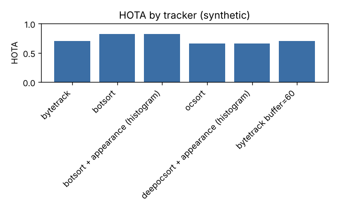
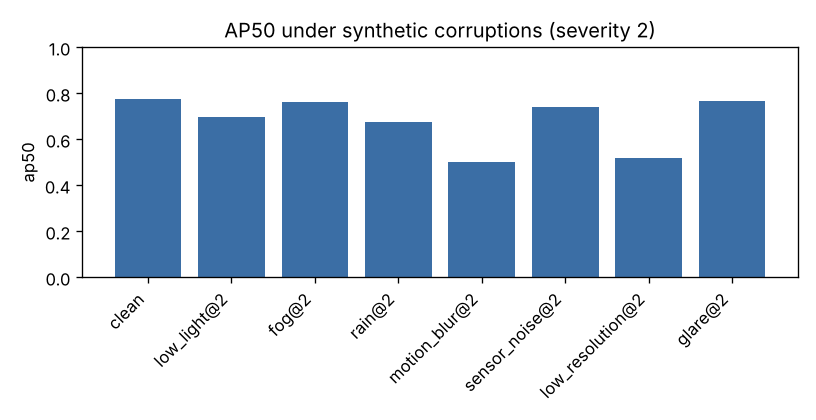

# Benchmark report

Generated 2026-10-16 12:08 by `python cli.py benchmark all`. All numbers measured in this run (glare rows re-measured after fixing glare severity scaling).

Hardware: 4 CPU cores, 16.9 GB RAM, CUDA available: False, device used: `cpu`. Python 3.13.16, torch 2.14.1+cu130, ultralytics 8.4.178, OpenCV 5.0.0.

## Detector speed (640x480 frames)

| name | fps | latency_ms_mean | latency_ms_p95 | detections_per_frame |
|---|---|---|---|---|
| yolo26n pytorch imgsz=320 | 51.010 | 19.600 | 25.280 | 4.050 |
| yolo26n pytorch imgsz=480 | 23.220 | 43.060 | 53.660 | 4.050 |
| yolo26n pytorch imgsz=640 | 17.120 | 58.430 | 71.130 | 4.200 |
| yolo26n onnxruntime imgsz=640 | 15.690 | 63.730 | 116.970 | 4.000 |

## End-to-end pipeline speed (60-frame 640x480 pan clip, 15 FPS source)

realtime_factor = processed FPS / FPS needed to keep up with the (sampled) source. Peak RSS is the process peak so far, so it only grows across rows.

| name | processing_fps | realtime_factor | detect_ms | track_ms | embed_or_reid_ms | latency_p95_ms | peak_rss_mb | track_ids |
|---|---|---|---|---|---|---|---|---|
| bytetrack | 18.170 | 1.211 | 49.120 | 0.970 | None | 63.170 | 1094.400 | 4 |
| botsort (GMC sparseOptFlow) | 15.580 | 1.039 | 52.350 | 7.570 | None | 77.420 | 1100.500 | 4 |
| botsort (no GMC) | 18.790 | 1.252 | 48.300 | 0.880 | None | 70.000 | 1100.500 | 4 |
| botsort + histogram appearance | 16.190 | 1.079 | 50.090 | 6.910 | 0.760 | 82.370 | 1100.900 | 5 |
| bytetrack + ReID labels (histogram) | 16.670 | 1.112 | 54.050 | 1.030 | 0.190 | 71.760 | 1102.900 | 4 |
| bytetrack, frame_stride=2 | 18.350 | 2.447 | 49.410 | 0.870 | None | 67.010 | 1105.600 | 4 |
| bytetrack, imgsz=320 | 28.850 | 1.923 | 28.920 | 1.020 | None | 44.170 | 1106.200 | 5 |

## Tracker comparison (SYNTHETIC crowd, simulated detector, mean of 3 seeds)

8 people on crossing paths, a pillar occluder, 10% misses, 4% box jitter, occasional false positives. Isolates association quality from detector quality; it is not a substitute for MOT17/MOT20.

| name | HOTA | DetA | AssA | idf1 | mota | num_switches | num_fragmentations | track_persistence | tracker_fps |
|---|---|---|---|---|---|---|---|---|---|
| bytetrack | 0.704 | 0.724 | 0.685 | 0.868 | 0.785 | 6.000 | 46.333 | 0.805 | 1277.934 |
| botsort | 0.824 | 0.822 | 0.825 | 0.946 | 0.899 | 0.333 | 40.000 | 0.897 | 1657.244 |
| botsort + appearance (histogram) | 0.824 | 0.823 | 0.825 | 0.947 | 0.899 | 0.333 | 40.333 | 0.897 | 517.078 |
| ocsort | 0.663 | 0.683 | 0.646 | 0.826 | 0.693 | 1.667 | 41.333 | 0.752 | 866.176 |
| deepocsort + appearance (histogram) | 0.664 | 0.682 | 0.647 | 0.823 | 0.690 | 2.000 | 41.333 | 0.764 | 169.733 |
| bytetrack buffer=60 | 0.704 | 0.724 | 0.685 | 0.868 | 0.785 | 6.000 | 46.333 | 0.805 | 1358.244 |

## Detection robustness (coco128 person subset, 128 images)

CAVEAT: coco128 images come from COCO train2017, which the pretrained detector was trained on, so absolute numbers are optimistic. The relative drop under each synthetic corruption is the informative part.

| name | precision | recall | f1 | ap50 | ap50_95 | num_gt | tp | fp | fn |
|---|---|---|---|---|---|---|---|---|---|
| clean | 0.866 | 0.661 | 0.750 | 0.776 | 0.539 | 254 | 168 | 26 | 86 |

### Synthetic corruptions (severity 1-3)

| name | precision | recall | f1 | ap50 | ap50_95 |
|---|---|---|---|---|---|
| low_light@1 | 0.856 | 0.606 | 0.710 | 0.722 | 0.484 |
| low_light@2 | 0.847 | 0.587 | 0.693 | 0.698 | 0.462 |
| low_light@3 | 0.865 | 0.528 | 0.655 | 0.658 | 0.411 |
| fog@1 | 0.869 | 0.653 | 0.746 | 0.773 | 0.531 |
| fog@2 | 0.880 | 0.634 | 0.737 | 0.763 | 0.515 |
| fog@3 | 0.885 | 0.547 | 0.676 | 0.713 | 0.473 |
| rain@1 | 0.878 | 0.567 | 0.689 | 0.733 | 0.485 |
| rain@2 | 0.871 | 0.531 | 0.660 | 0.676 | 0.433 |
| rain@3 | 0.828 | 0.417 | 0.555 | 0.561 | 0.347 |
| motion_blur@1 | 0.884 | 0.598 | 0.714 | 0.709 | 0.491 |
| motion_blur@2 | 0.743 | 0.409 | 0.528 | 0.503 | 0.310 |
| motion_blur@3 | 0.683 | 0.280 | 0.397 | 0.335 | 0.182 |
| sensor_noise@1 | 0.840 | 0.622 | 0.715 | 0.773 | 0.528 |
| sensor_noise@2 | 0.848 | 0.614 | 0.712 | 0.741 | 0.500 |
| sensor_noise@3 | 0.853 | 0.547 | 0.667 | 0.690 | 0.453 |
| low_resolution@1 | 0.904 | 0.520 | 0.660 | 0.692 | 0.456 |
| low_resolution@2 | 0.853 | 0.390 | 0.535 | 0.520 | 0.330 |
| low_resolution@3 | 0.770 | 0.264 | 0.393 | 0.366 | 0.211 |
| glare@1 | 0.866 | 0.661 | 0.750 | 0.774 | 0.535 |
| glare@2 | 0.856 | 0.634 | 0.729 | 0.766 | 0.530 |
| glare@3 | 0.840 | 0.598 | 0.699 | 0.738 | 0.495 |

## Enhancement A/B (does preprocessing help?)

### original images

| name | ap50 | ap50_95 | recall | precision |
|---|---|---|---|---|
| none | 0.776 | 0.539 | 0.661 | 0.866 |
| clahe | 0.774 | 0.533 | 0.638 | 0.857 |
| gamma | 0.779 | 0.533 | 0.630 | 0.874 |
| clahe_gamma | 0.770 | 0.530 | 0.638 | 0.880 |
| dehaze | 0.773 | 0.539 | 0.653 | 0.883 |

### synthetic low light @2

| name | ap50 | ap50_95 | recall | precision |
|---|---|---|---|---|
| none | 0.698 | 0.462 | 0.587 | 0.847 |
| clahe | 0.718 | 0.470 | 0.598 | 0.869 |
| gamma | 0.749 | 0.507 | 0.634 | 0.843 |
| clahe_gamma | 0.737 | 0.486 | 0.610 | 0.842 |
| dehaze | 0.689 | 0.457 | 0.579 | 0.840 |

### synthetic low light @3

| name | ap50 | ap50_95 | recall | precision |
|---|---|---|---|---|
| none | 0.658 | 0.411 | 0.528 | 0.865 |
| clahe | 0.680 | 0.424 | 0.555 | 0.844 |
| gamma | 0.711 | 0.462 | 0.595 | 0.848 |
| clahe_gamma | 0.696 | 0.454 | 0.587 | 0.851 |
| dehaze | 0.652 | 0.403 | 0.516 | 0.897 |

### synthetic fog @3

| name | ap50 | ap50_95 | recall | precision |
|---|---|---|---|---|
| none | 0.713 | 0.473 | 0.547 | 0.885 |
| dehaze | 0.758 | 0.521 | 0.650 | 0.855 |
| clahe | 0.758 | 0.506 | 0.595 | 0.873 |

## Fine-tuning smoke test (coco128 person, 3 epochs, CPU, imgsz 320, AdamW lr0=1e-4)

Training ran for 0.4 min and wrote checkpoints to `models/runs/coco128_smoke`. Test split: 19 images (group-aware split, seed 42). This only demonstrates that training, checkpointing and baseline-vs-fine-tuned comparison work; 3 epochs on ~90 images is not expected to improve a COCO-pretrained model, and the test images were part of its pretraining data.

| name | precision | recall | f1 | ap50 | ap50_95 | num_gt |
|---|---|---|---|---|---|---|
| baseline yolo26n (imgsz 320) | 0.769 | 0.345 | 0.476 | 0.547 | 0.318 | 29 |
| fine-tuned 3 epochs (imgsz 320) | 0.769 | 0.345 | 0.476 | 0.539 | 0.315 | 29 |

